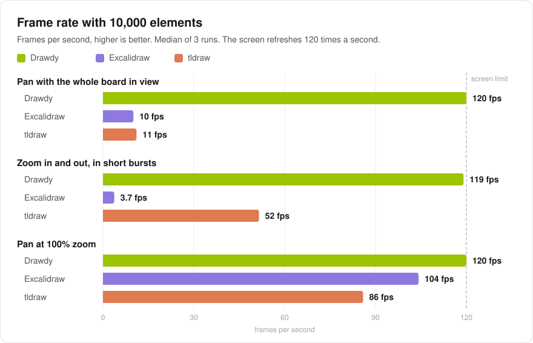
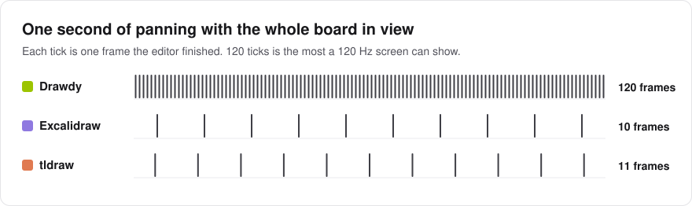
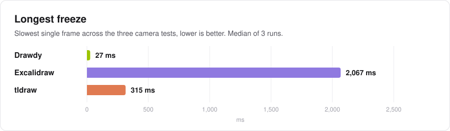
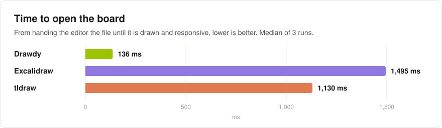
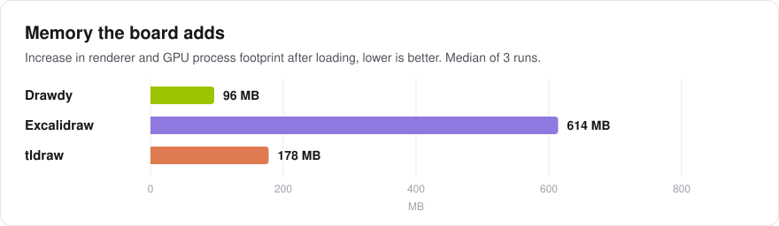
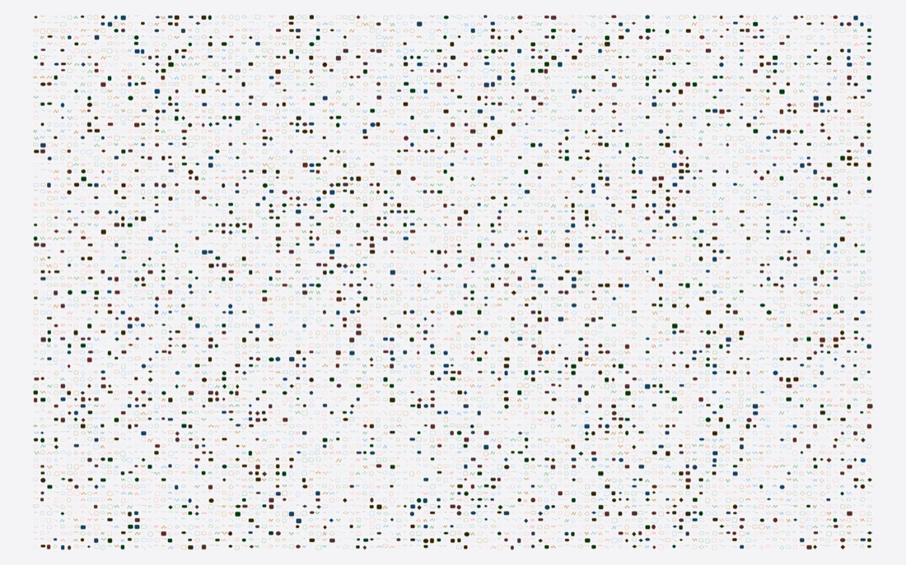
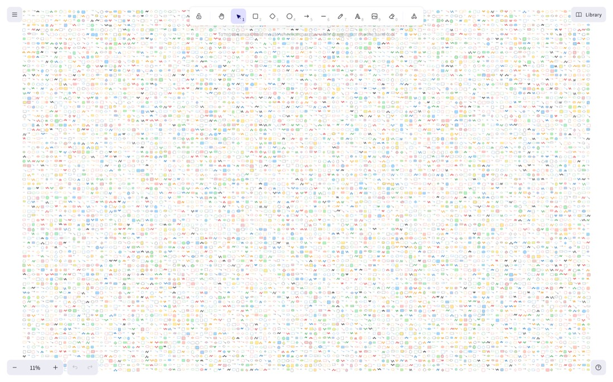
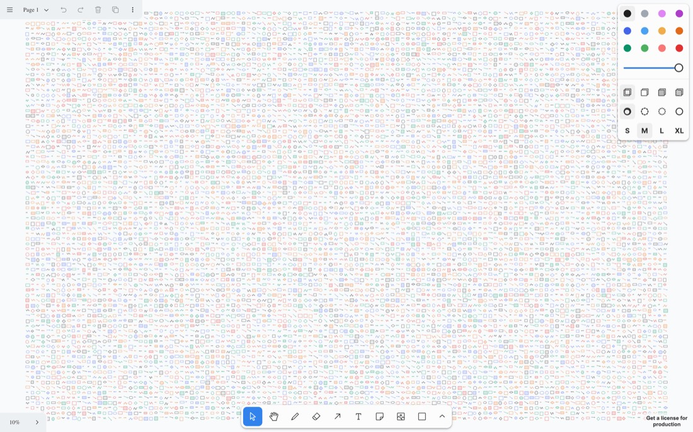
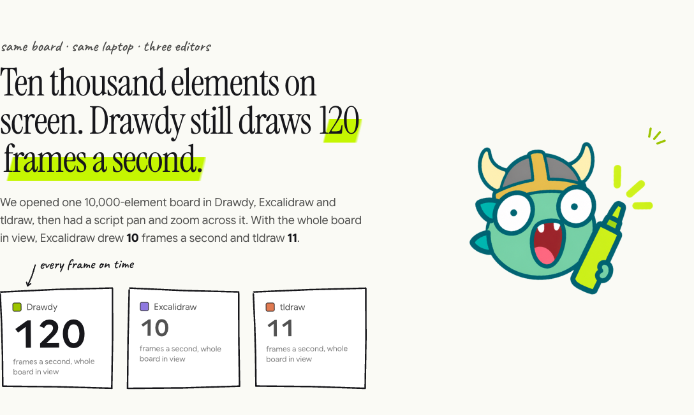

# 10,000 elements: Drawdy vs Excalidraw vs tldraw

We opened the same 10,000-element board in Drawdy, Excalidraw and tldraw on one laptop, then had a script pan and zoom across it and timed how long each took to open. Measured 24 September 2026. How it was done: [METHODOLOGY.md](METHODOLOGY.md).

**Re-checked on 2 November 2026** with tldraw 5.6.0, the latest Drawdy and Chrome 155: the results hold. See [the re-check](../2026-11-02-canvas-10k-recheck/).

## Results at a glance

- **Whole board on screen:** Drawdy draws 120 frames a second, the most the screen can show. Excalidraw draws 10 and tldraw 11, so Drawdy draws 11 to 12 times as many frames.
- **Zooming in and out:** Drawdy stays at 119 fps. tldraw drops to 52 fps and Excalidraw to 3.7 fps, with single frames up to 2 seconds long.
- **Working at 100% zoom:** all three stay usable. Drawdy 120 fps, Excalidraw 104, tldraw 86.
- **Opening the board:** Drawdy takes 0.14 s, tldraw 1.1 s and Excalidraw 1.5 s.
- **Memory:** the board adds 96 MB in Drawdy, 178 MB in tldraw and 614 MB in Excalidraw.











## All results

Median of 3 runs per editor, each in a fresh browser.

| Measurement | Drawdy | Excalidraw | tldraw |
|---|---:|---:|---:|
| Frame rate, whole board in view | **120 fps** | 10 fps | 11 fps |
| Frame rate, zoom in and out | **119 fps** | 3.7 fps | 52 fps |
| Frame rate, pan at 100% zoom | **120 fps** | 104 fps | 86 fps |
| 95th percentile frame, whole board in view | **10 ms** | 107 ms | 116 ms |
| 95th percentile frame, zoom in and out | **10 ms** | 1,676 ms | 76 ms |
| 95th percentile frame, pan at 100% zoom | **10 ms** | 10 ms | 18 ms |
| Frames over 50 ms, whole board in view | **0** | 61 | 67 |
| Frames over 50 ms, zoom in and out | **0** | 11 | 17 |
| Longest freeze | **27 ms** | 2,067 ms | 315 ms |
| Time to open the board | **136 ms** | 1,495 ms | 1,130 ms |
| Memory added (renderer + GPU footprint) | **96 MB** | 614 MB | 178 MB |
| JavaScript heap added | **18 MB** | 27 MB | 253 MB |
| Elements loaded | 10,000 | 10,000 | 10,000 |

One screen refresh at 120 Hz is 8.3 ms. A 95th percentile of 10 ms means 95% of frames finished within 10 ms. Frames over 50 ms are long enough to see as stutter.

### Spread across runs

Lowest and highest value over the 3 runs.

| Measurement | Drawdy | Excalidraw | tldraw |
|---|---:|---:|---:|
| Frame rate, whole board in view (fps) | 120.0 to 120.1 | 10.0 to 10.2 | 11.0 to 11.3 |
| Frame rate, zoom in and out (fps) | 118.7 to 119.2 | 3.6 to 5.7 | 51.5 to 54.6 |
| Frame rate, pan at 100% zoom (fps) | 119.8 to 120.0 | 93.4 to 104.5 | 85.8 to 86.6 |
| Longest freeze (ms) | 25 to 27 | 1,983 to 2,171 | 300 to 334 |
| Time to open the board (ms) | 133 to 160 | 1,460 to 1,521 | 1,127 to 1,135 |
| Memory added (MB) | 41 to 108 | 603 to 639 | 134 to 186 |

## What was on screen

Each editor right after opening the board, zoomed to fit. All three drew the full grid.

| Drawdy | Excalidraw | tldraw |
|---|---|---|
|  |  |  |

## Method in short

- **Machine:** MacBook Pro, Apple M4 Pro, 24 GB, Chrome 153, 1440 × 900 window at 2×, 120 Hz screen.
- **Board:** 10,000 generated elements in a 125 × 80 grid (rectangles, ellipses, diamonds, arrows, text labels, pen strokes), the same for every editor.
- **Editors:** Drawdy at commit `747286dd`, `@excalidraw/excalidraw` 0.18.1, `tldraw` 5.4.2, production builds with default settings.
- **Tests:** each editor opens the board through its own importer, then a script moves its camera through its public API on three identical paths for 6 s each.
- **Statistics:** 3 runs per editor in rotating order, medians reported.

Full details, formulas and limitations: [METHODOLOGY.md](METHODOLOGY.md).

## Read these before quoting the numbers

1. **tldraw stops at 4,000 shapes per page by default**, so this board does not open in a stock tldraw editor. For the test we raised its `maxShapesPerPage` option to 10,000.
2. **Drawdy ran without the drawdy.io toolbar and panels**; Excalidraw and tldraw ran with their default UI.
3. **The zoom test pauses between bursts on purpose**, so Drawdy's sharp redraw after each zoom is inside the measurement. It accounts for Drawdy's 27 ms longest frame.
4. **One laptop.** Absolute numbers will differ on other hardware; see [Limitations](METHODOLOGY.md#limitations).

## Why Drawdy stays fast

Drawdy draws the board into cached 1,024 px tiles at a few zoom levels and finds elements through a spatial index written in Rust and compiled to WebAssembly. Panning places tiles that are already drawn instead of redrawing 10,000 shapes. This study measures Excalidraw and tldraw from the outside and does not profile why their frames take longer.

## Results page

[`index.html`](index.html) is the hand-drawn results page, with an animation of each editor's frame rate. It is a single file with the data and screenshots built in; its styles and fonts load from CDNs, so it needs an internet connection. Clone the repo and open it in a browser:

```sh
gh repo clone drawdyio/drawdy-benchmarks && open drawdy-benchmarks/2026-09-24-canvas-10k/index.html
```



## Files

| Path | Contents |
|---|---|
| `METHODOLOGY.md` | Environment, test board, loading, camera paths, metrics, statistics, fairness decisions, limitations |
| `results.json` | Every run's raw numbers plus machine and version details |
| `charts/` | The charts above, generated from `results.json` by `node scripts/charts.mjs 2026-09-24-canvas-10k` |
| `index.html` | The hand-drawn results page |
| `images/` | Editor screenshots and the page preview |

## Licences

Excalidraw is MIT licensed. The tldraw licence allows use in development and testing environments and has no clause about publishing benchmarks (checked 28 Sep 2026).
