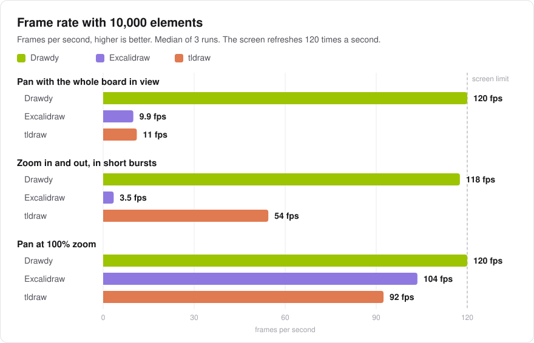
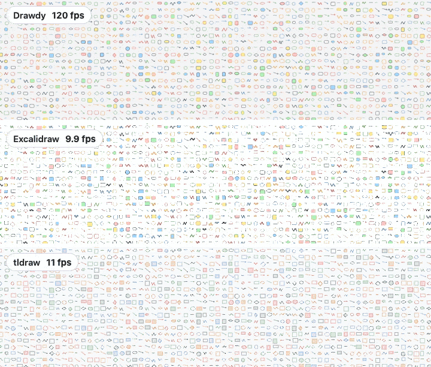
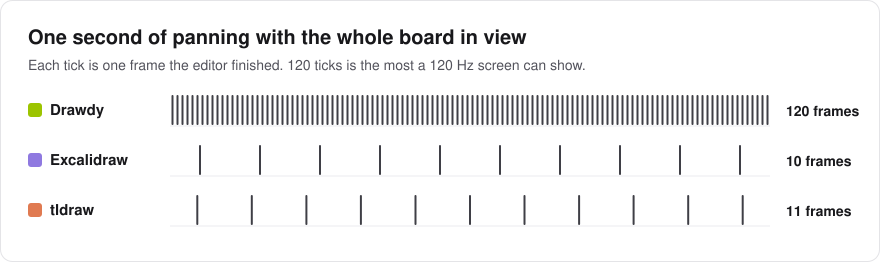
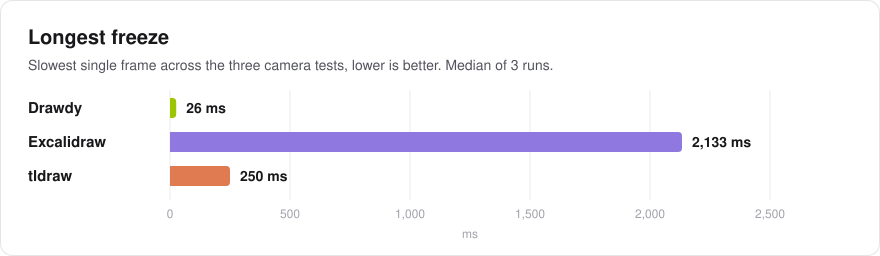
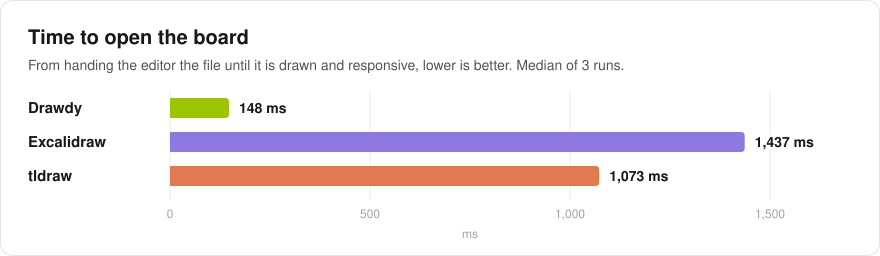
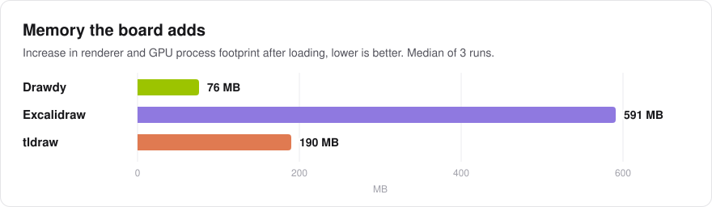
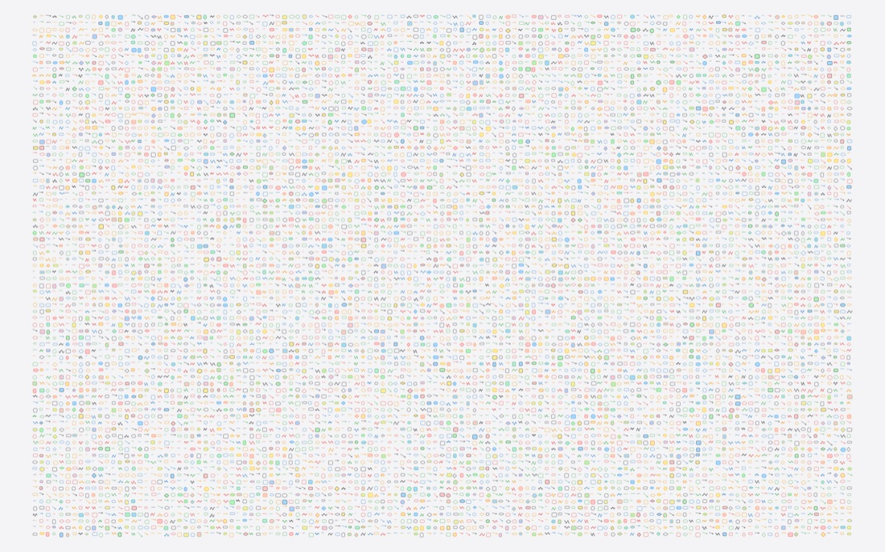
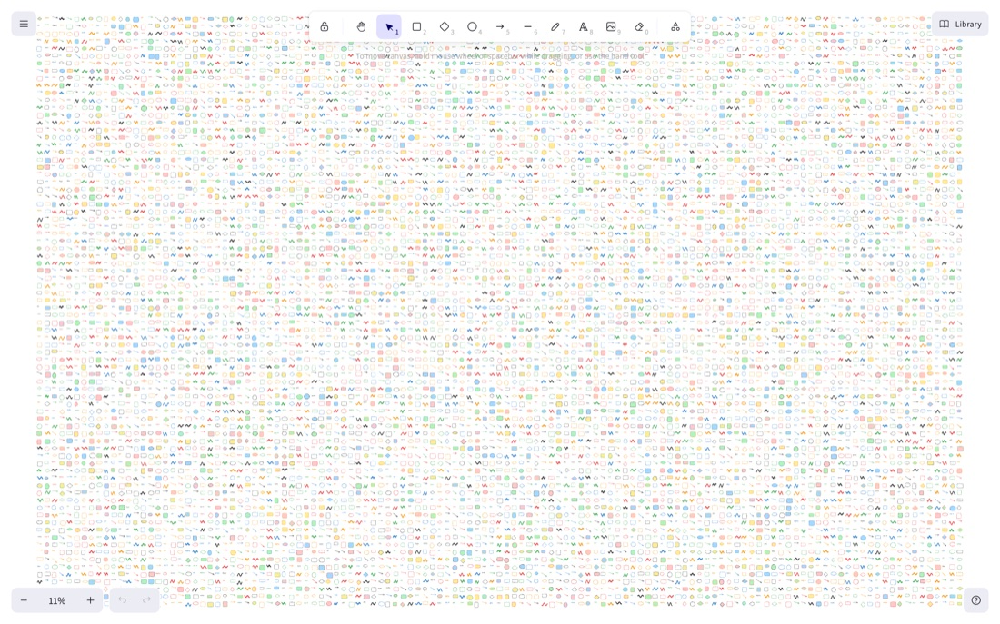
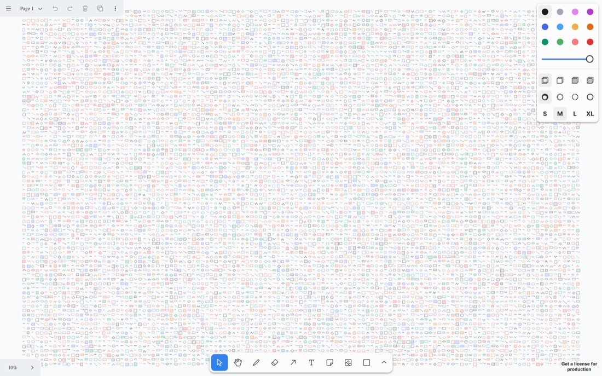

# 10,000 elements, re-checked: Drawdy vs Excalidraw vs tldraw

On 2 November 2026 we re-ran the [24 September 2026 study](../2026-09-24-canvas-10k/) with the latest version of each editor: same laptop, same board, same camera paths, same harness. How it was done: [METHODOLOGY.md](../2026-09-24-canvas-10k/METHODOLOGY.md).

## Result

The September results hold. With all 10,000 elements in view, Drawdy pans at 120 fps, Excalidraw at 9.9 and tldraw at 11. The largest change is tldraw panning at 100% zoom, up from 86 to 92 fps.

*Real renders from each editor on the whole-board pan path. Each row shows a new frame only as often as that editor drew one in this benchmark (median frame rate). A GIF plays at most 50 frames a second, so Drawdy's 120 shows as 50 here.*

## What changed since 24 September

| | 24 Sep 2026 | 2 Nov 2026 |
|---|---|---|
| Drawdy | commit `747286dd` | commit `f458b2c1c` |
| Excalidraw | `@excalidraw/excalidraw` 0.18.1 | 0.18.1, still the latest release |
| tldraw | `tldraw` 5.4.2 | 5.6.0, the latest release |
| Chrome | 153.0.8010.53 | 155.0.8059.85 |
| Measured refresh rate | 120.3 Hz | 120.0 Hz |

The machine, window, board, loading, camera paths, metrics and statistics are unchanged. tldraw 5.6.0 still stops at 4,000 shapes per page by default, so its `maxShapesPerPage` option was again raised to 10,000.

## All results

Median of 3 runs per editor, each in a fresh browser. The 24 September value is in brackets.

| Measurement | Drawdy | Excalidraw | tldraw |
|---|---:|---:|---:|
| Frame rate, whole board in view | **120 fps** (120) | 9.9 fps (10) | 11 fps (11) |
| Frame rate, zoom in and out | **118 fps** (119) | 3.5 fps (3.7) | 54 fps (52) |
| Frame rate, pan at 100% zoom | **120 fps** (120) | 104 fps (104) | 92 fps (86) |
| 95th percentile frame, whole board in view | **9 ms** (10) | 108 ms (107) | 116 ms (116) |
| 95th percentile frame, zoom in and out | **9 ms** (10) | 2,133 ms (1,676) | 67 ms (76) |
| 95th percentile frame, pan at 100% zoom | **9 ms** (10) | 9 ms (10) | 17 ms (18) |
| Frames over 50 ms, whole board in view | **0** (0) | 60 (61) | 66 (67) |
| Frames over 50 ms, zoom in and out | **0** (0) | 11 (11) | 17 (17) |
| Longest freeze | **26 ms** (27) | 2,133 ms (2,067) | 250 ms (315) |
| Time to open the board | **148 ms** (136) | 1,437 ms (1,495) | 1,073 ms (1,130) |
| Memory added (renderer + GPU footprint) | **76 MB** (96) | 591 MB (614) | 190 MB (178) |
| JavaScript heap added | **18 MB** (18) | 28 MB (27) | 255 MB (253) |
| Elements loaded | 10,000 | 10,000 | 10,000 |

### Spread across runs

Lowest and highest value over the 3 runs.

| Measurement | Drawdy | Excalidraw | tldraw |
|---|---:|---:|---:|
| Frame rate, whole board in view (fps) | 120.0 to 120.0 | 9.8 to 10.3 | 11.0 to 11.5 |
| Frame rate, zoom in and out (fps) | 116.5 to 118.3 | 2.3 to 5.7 | 54.4 to 54.7 |
| Frame rate, pan at 100% zoom (fps) | 120.0 to 120.0 | 93.4 to 119.7 | 91.5 to 93.2 |
| Longest freeze (ms) | 26 to 42 | 1,558 to 3,075 | 233 to 258 |
| Time to open the board (ms) | 144 to 168 | 1,410 to 1,532 | 1,060 to 1,082 |
| Memory added (MB) | 60 to 98 | 583 to 732 | 126 to 324 |

Drawdy's 42 ms frame came in one run of the zoom test. No Drawdy frame took longer than 50 ms in any run.

## What was on screen

Each editor right after opening the board, zoomed to fit. All three drew the full grid.

| Drawdy | Excalidraw | tldraw |
|---|---|---|
|  |  |  |

## Before quoting the numbers

The [caveats of the September study](../2026-09-24-canvas-10k/README.md#read-these-before-quoting-the-numbers) still apply: tldraw's shape limit was raised, Drawdy ran without its app toolbar and panels, the zoom test pauses on purpose, and everything ran on one laptop.

tldraw's licence was checked again on 2 November 2026. It has not changed since September 2025, allows use in development and testing environments and has no clause about publishing benchmarks.

## Files

| Path | Contents |
|---|---|
| `results.json` | Every run's raw numbers plus machine and version details, in the same format as the September study |
| `charts/` | The charts above, generated from `results.json` by `node scripts/charts.mjs 2026-11-02-canvas-10k-recheck` |
| `images/` | Editor screenshots, and `whole-board-pan.gif`: a 720 × 200 px crop from the centre of each editor's view, 4 s (one lap of the camera path) at 50 frames a second |
