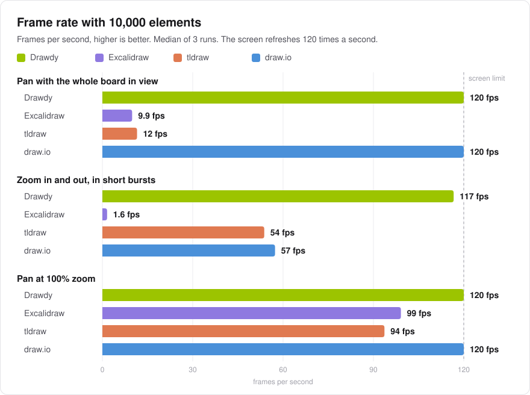
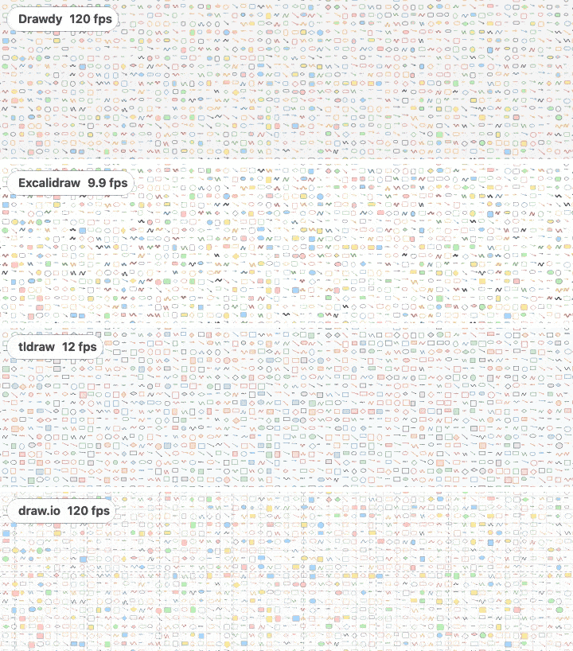
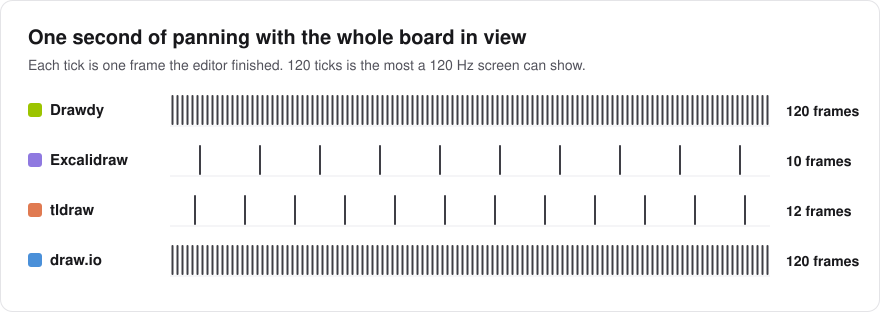
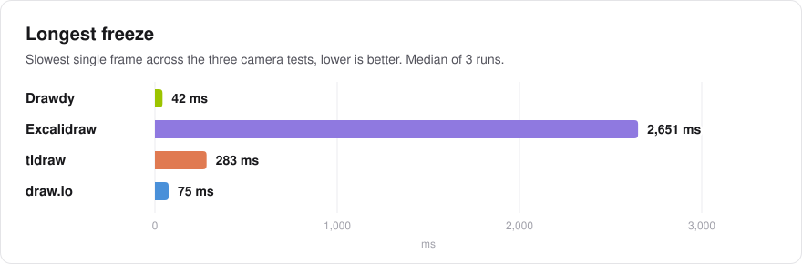
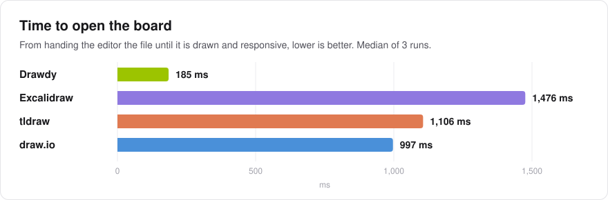
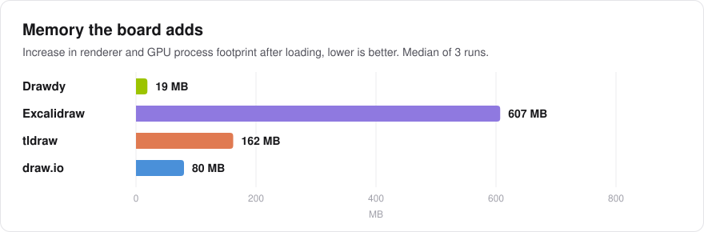
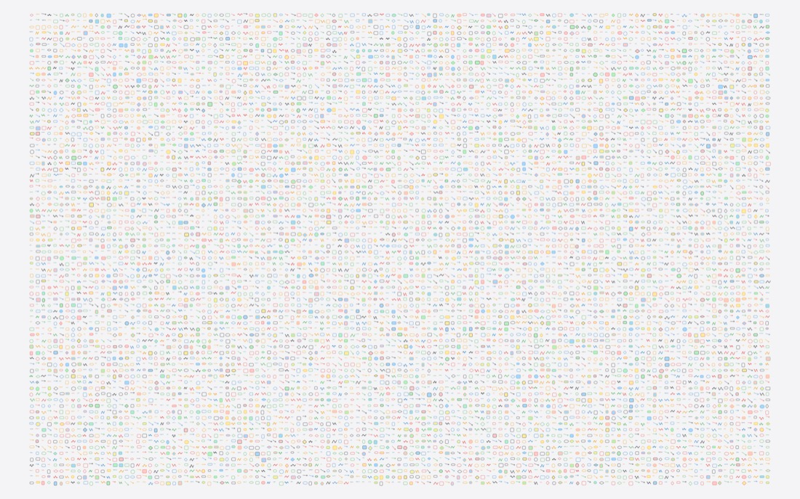
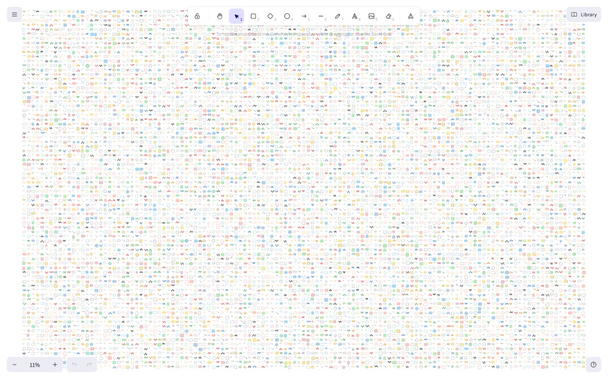
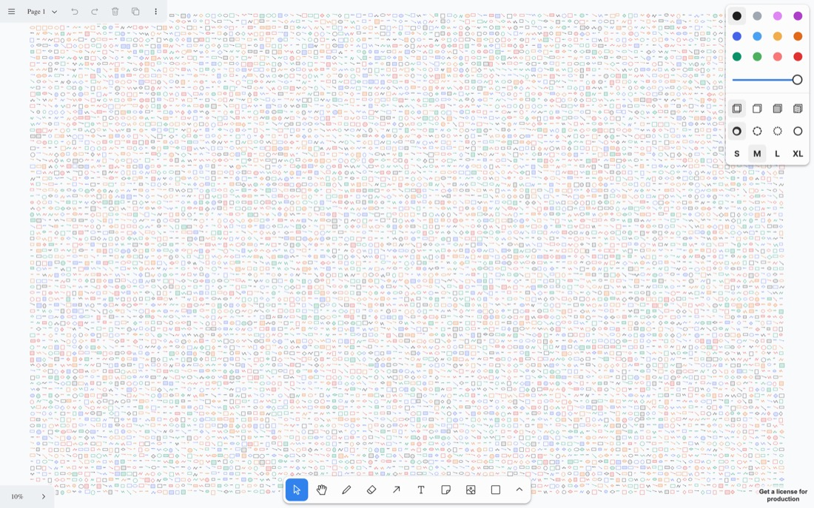
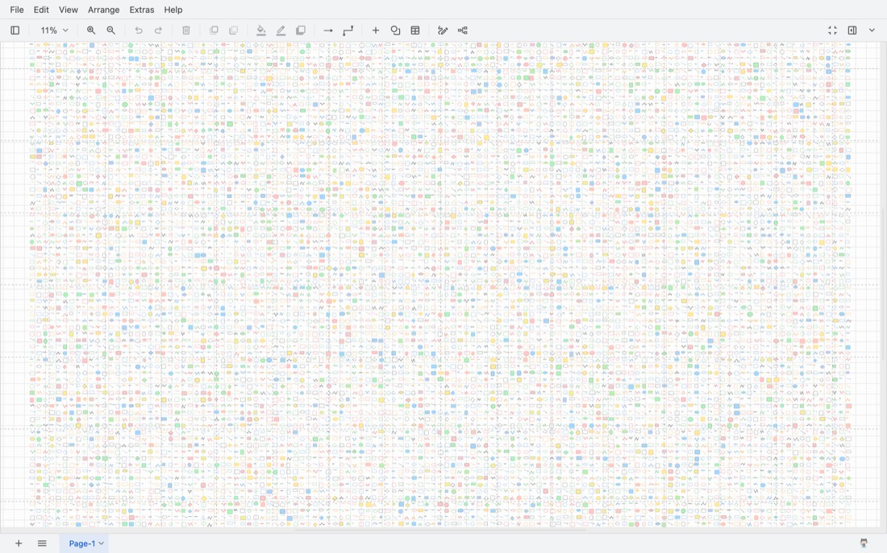

# 10,000 elements with draw.io added: Drawdy vs Excalidraw vs tldraw vs draw.io

On 7 November 2026 we added draw.io to the [10,000-element benchmark](../2026-09-24-canvas-10k/) and ran all four editors at their latest versions: same laptop, same board, same camera paths, same harness. How it was done: [METHODOLOGY.md](../2026-09-24-canvas-10k/METHODOLOGY.md), plus [how draw.io was tested](#how-drawio-was-tested) below.

## Result

draw.io pans as smoothly as Drawdy: 120 fps with the whole board in view and at 100% zoom, where Excalidraw manages 9.9 and tldraw 12 with the whole board in view. draw.io gets there by scrolling a picture it has already painted ([why](#why-drawio-pans-at-120-fps)). Drawdy is ahead on everything else: it zooms at 117 fps against draw.io's 57, though the two draw differently while zooming ([see below](#why-drawio-pans-at-120-fps)), opens the board in 0.19 s (draw.io 1.0 s), its slowest frame is 42 ms (draw.io 75 ms), and its renderer process grows by 55 MB (draw.io 264 MB). Excalidraw's and tldraw's results are close to 2 November's.

*Real renders from each editor on the whole-board pan path. Each row shows a new frame only as often as that editor drew one in this benchmark (median frame rate). A GIF plays at most 50 frames a second, so Drawdy's and draw.io's 120 show as 50 here.*

## How draw.io was tested

Everything not listed here is as in the [September methodology](../2026-09-24-canvas-10k/METHODOLOGY.md).

| | |
|---|---|
| Version | draw.io 32.6.10, the `draw.war` web app from its GitHub release of 4 November 2026, served from `localhost` |
| How it was mounted | The full draw.io app with its default UI, in a same-origin iframe of the test page, so it shares the page's process and main thread. One added script runs before draw.io's `main.js` and keeps a reference to the editor when draw.io starts. The app is opened with `?gapi=0`, so it does not load the Google Drive client from apis.google.com. |
| Side panels | Closed with draw.io's own fullscreen button on its toolbar. draw.io's shape and format panels sit beside the canvas, not over it: with them open the canvas is 958 × 756 px and about a third of the board would be out of view. With them closed the canvas is 1,428 × 790 px. |
| Board | The same 10,000 elements as a 4.35 MB `.drawio` file, in the styles draw.io's own shapes use: rounded rectangles, ellipses and rhombuses with stroke width 2, arrows as unconnected edges with draw.io's classic arrowhead, labels as HTML text cells, and pen strokes as the stencil shape draw.io's freehand tool saves, outlined by draw.io's own `PerfectFreehand` code with its default brush. Shapes use draw.io's default clean style, not its sketch style. |
| Opening the board | `openLocalFile()`, the path File > Open and drag and drop use. Opening a file resets draw.io's zoom to 100%, so the script sets the fit zoom again straight after, inside the timed open. |
| Camera | `graph.view.setScale(zoom)` when the zoom changes, then the canvas's `scrollLeft` and `scrollTop` to centre the camera point. draw.io's default view has scrollbars, and panning in draw.io means scrolling. |

### Why draw.io pans at 120 fps

draw.io draws the board as one SVG and pans by scrolling the element that holds it, so nothing has to be redrawn. Drawdy also pans without redrawing, by placing tiles it has already drawn. A Chrome trace of the pans shows, per frame, about 0.1 ms in draw.io's own code (its scroll handlers) and about 3 ms of main-thread work in total, with no repaint of the SVG's shapes; Chrome turns the already-recorded drawing into pixels on background threads and the GPU as the view moves. In the same trace the GPU process put 118 to 119 frames a second on screen, matching the frame timer. A screen recording of the 100% zoom pan showed no blank, not-yet-drawn areas. Zooming changes the SVG's scale, so Chrome has to paint all 10,000 elements again. That is where draw.io slows down: 57 fps, with 8 frames over 50 ms.

draw.io's own mouse-wheel zoom shows a scaled copy of the old picture and redraws 0.5 s after the wheel stops, longer than this test's 0.25 s pauses, so its redraws would fall outside the measurement. The script sets the zoom through draw.io's graph API instead, so draw.io redraws at its true zoom on every frame, as Excalidraw and tldraw do. Drawdy, driven through its own API, scales its cached tiles while the zoom moves and redraws them sharp 80 ms after each stop. The zoom test therefore compares Drawdy's scaled-then-sharp drawing with a full redraw on every draw.io frame.

## All results

Median of 3 runs per editor, each in a fresh browser. The 2 November value is in brackets; draw.io is new in this study.

| Measurement | Drawdy | Excalidraw | tldraw | draw.io |
|---|---:|---:|---:|---:|
| Frame rate, whole board in view | **120 fps** (120) | 9.9 fps (9.9) | 12 fps (11) | **120 fps** |
| Frame rate, zoom in and out | **117 fps** (118) | 1.6 fps (3.5) | 54 fps (54) | 57 fps |
| Frame rate, pan at 100% zoom | **120 fps** (120) | 99 fps (104) | 94 fps (92) | **120 fps** |
| 95th percentile frame, whole board in view | **9 ms** (9) | 108 ms (108) | 117 ms (116) | **9 ms** |
| 95th percentile frame, zoom in and out | **9 ms** (9) | 2,651 ms (2,133) | 74 ms (67) | 43 ms |
| 95th percentile frame, pan at 100% zoom | **9 ms** (9) | **9 ms** (9) | 17 ms (17) | **9 ms** |
| Frames over 50 ms, whole board in view | **0** (0) | 60 (60) | 66 (66) | **0** |
| Frames over 50 ms, zoom in and out | **0** (0) | 8 (11) | 17 (17) | 8 |
| Longest freeze | **42 ms** (26) | 2,651 ms (2,133) | 283 ms (250) | 75 ms |
| Time to open the board | **185 ms** (148) | 1,476 ms (1,437) | 1,106 ms (1,073) | 997 ms |
| Memory added (renderer + GPU footprint) | **19 MB** (76) | 607 MB (591) | 162 MB (190) | 80 MB |
| Renderer process footprint added | **55 MB** (51) | 462 MB (463) | 454 MB (456) | 264 MB |
| JavaScript heap added | **19 MB** (18) | 27 MB (28) | 255 MB (255) | 49 MB |
| Elements loaded | 10,000 | 10,000 | 10,000 | 10,000 |

The renderer-only row is new. The GPU process is shared by the whole browser, and in most runs of this study its footprint shrank while the board loaded, which pulled the renderer + GPU totals down, once below zero (Drawdy, run 3: −18 MB). The renderer process alone varied by under 10 MB between runs for every editor.

### Spread across runs

Lowest and highest value over the 3 runs.

| Measurement | Drawdy | Excalidraw | tldraw | draw.io |
|---|---:|---:|---:|---:|
| Frame rate, whole board in view (fps) | 120.0 to 120.0 | 9.1 to 10.2 | 7.7 to 11.6 | 120.0 to 120.0 |
| Frame rate, zoom in and out (fps) | 116.3 to 116.7 | 1.1 to 4.6 | 51.1 to 54.1 | 38.0 to 57.5 |
| Frame rate, pan at 100% zoom (fps) | 120.0 to 120.0 | 85.7 to 119.2 | 93.1 to 94.2 | 120.0 to 120.0 |
| Longest freeze (ms) | 42 to 42 | 1,642 to 2,775 | 283 to 300 | 67 to 370 |
| Time to open the board (ms) | 183 to 559 | 811 to 1,537 | 1,038 to 1,112 | 977 to 1,125 |
| Memory added (MB) | −18 to 88 | 588 to 623 | 76 to 168 | 70 to 120 |
| Renderer process footprint added (MB) | 55 to 56 | 454 to 463 | 452 to 457 | 260 to 265 |

Drawdy's 559 ms open and tldraw's 7.7 fps each came in a single run; the other two runs were close to 2 November. Drawdy's 42 ms frame came in the zoom test in every run, as it did once on 2 November. draw.io's 370 ms frame came in one run of the zoom test.

## What changed since 2 November

| | 2 Nov 2026 | 7 Nov 2026 |
|---|---|---|
| Drawdy | commit `f458b2c1c` | commit `98c74da9f` |
| Excalidraw | `@excalidraw/excalidraw` 0.18.1 | 0.18.1, still the latest release |
| tldraw | `tldraw` 5.6.0 | 5.6.0, still the latest release |
| draw.io | not tested | 32.6.10, the latest release |
| Chrome | 155.0.8059.85 | 156.0.8078.80 |
| Measured refresh rate | 120.0 Hz | 120.0 Hz |

The machine, window, board, camera paths, metrics and statistics are unchanged. tldraw's `maxShapesPerPage` option was again raised to 10,000. With four editors the run order rotates across four positions instead of three.

## What was on screen

Each editor right after opening the board, zoomed to fit. All four drew the full grid; draw.io's shorter canvas cuts a strip off the top and bottom.

| Drawdy | Excalidraw | tldraw | draw.io |
|---|---|---|---|
|  |  |  |  |

## Before quoting the numbers

1. **The [September caveats](../2026-09-24-canvas-10k/README.md#read-these-before-quoting-the-numbers) still apply:** tldraw's shape limit was raised, Drawdy ran without its app toolbar and panels, the zoom test pauses on purpose, and everything ran on one laptop.
2. **draw.io ran with its side panels closed.** Its canvas is still shorter than the window, 790 px under its menu bar and toolbar. The board at the fit zoom is about 1,336 × 855 px, so a strip of about 30 px at the top and bottom was out of view. The other editors drew on the full 1,440 × 900 window.
3. **draw.io drew clean shapes.** Excalidraw, tldraw and Drawdy drew their default hand-drawn styles, which take more work to draw.
4. **Panning shows drawing from a cache, for Drawdy and draw.io alike.** Drawdy places tiles it has already drawn; draw.io scrolls an SVG Chrome has already drawn. The frames are real frames on screen.
5. **The zoom test is not like for like between Drawdy and draw.io.** Drawdy shows scaled cached tiles while the zoom moves and redraws them 80 ms after each stop; draw.io was made to redraw fully on every frame. With its own wheel zoom, draw.io would also show scaled pictures, redrawn 0.5 s after the wheel stops, which this test's 0.25 s pauses never reach.
6. **The machine was not idle.** During the runs, macOS storage indexing and another app used about 2 of the 12 cores. Excalidraw's and tldraw's frame rates are within 5% of 2 November, except Excalidraw's zoom test: 1.6 fps against 3.5, from runs of 1.1 to 4.6 fps (2.3 to 5.7 on 2 November).

## Licences

draw.io is licensed under Apache 2.0, which allows this use and has no clause about publishing benchmarks (checked 7 November 2026). The [September licence notes](../2026-09-24-canvas-10k/README.md#licences) for Excalidraw and tldraw still apply.

## Files

| Path | Contents |
|---|---|
| `results.json` | Every run's raw numbers plus machine and version details, in the same format as the earlier studies |
| `charts/` | The charts above, generated from `results.json` by `node scripts/charts.mjs 2026-11-07-canvas-10k-drawio` |
| `images/` | Editor screenshots, and `whole-board-pan.gif`: a 720 × 200 px crop from the centre of each editor's canvas, 4 s (one lap of the camera path) at 50 frames a second |
