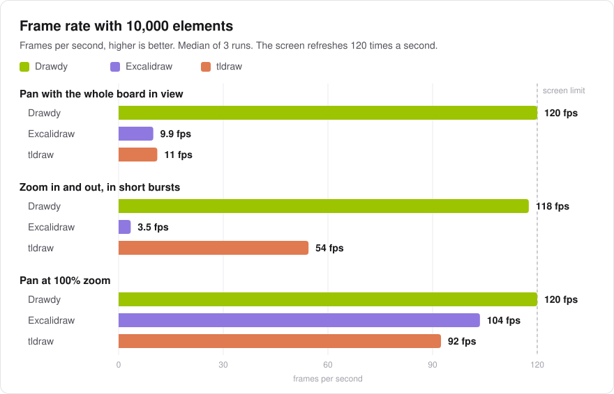

# Drawdy benchmarks

Performance studies of Drawdy against other whiteboard editors. Each study has its own dated folder with the results, the methodology and the raw data.

| Study | Measured | Editors | Result |
|---|---|---|---|
| [10,000-element canvas, re-check](2026-11-02-canvas-10k-recheck/) ([method](2026-09-24-canvas-10k/METHODOLOGY.md)) | 2 Nov 2026 | Drawdy, Excalidraw 0.18.1, tldraw 5.6.0 | Same result with the latest versions: with all 10,000 elements in view, Drawdy pans at 120 fps, Excalidraw at 9.9 and tldraw at 11 |
| [10,000-element canvas](2026-09-24-canvas-10k/) ([method](2026-09-24-canvas-10k/METHODOLOGY.md)) | 24 Sep 2026 | Drawdy, Excalidraw 0.18.1, tldraw 5.4.2 | With all 10,000 elements in view, Drawdy pans at 120 fps, Excalidraw at 10 and tldraw at 11 |



Charts are generated from each study's `results.json`:

```sh
node scripts/charts.mjs 2026-11-02-canvas-10k-recheck
```

## Licence

© 2026 Pichaya Puttekulangkura. The scripts in `scripts/` are licensed under the [MIT licence](LICENSE-MIT). Everything else (results, documentation, charts, images and results pages) is licensed under [CC BY 4.0](LICENSE-CC-BY-4.0): you can reuse it with credit. The Excalidraw and tldraw interfaces shown in the screenshots belong to their owners.
